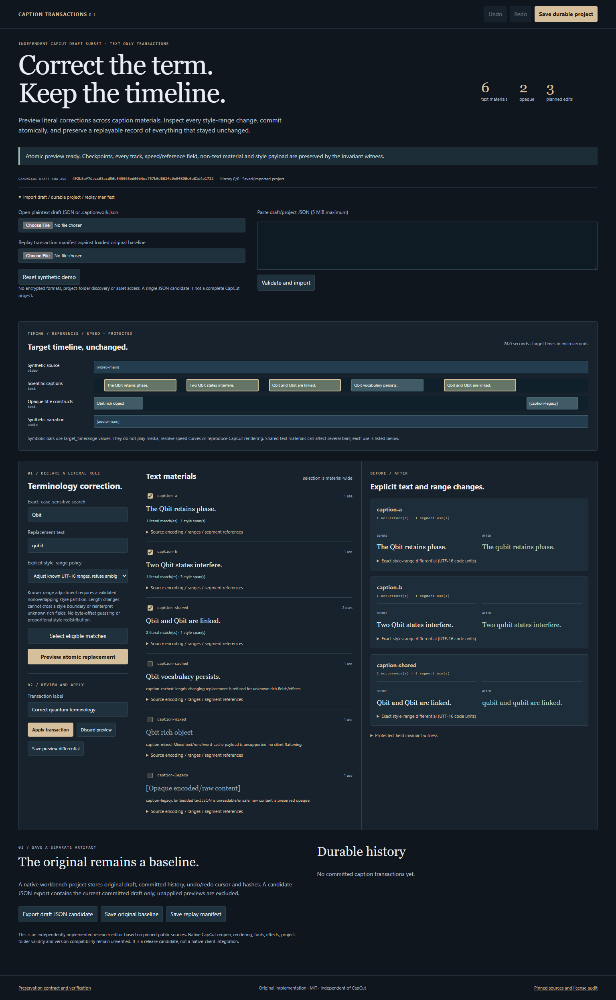

# Caption Transactions

Changing a word in a video subtitle can affect more than its spelling. This editor shows the text and formatting changes together, checks the supported timing and media data, and keeps a record you can undo.

Imagine standardizing a term across a video. A longer replacement word can shift which letters are bold, and the same saved caption text may be used in more than one place. A search-and-replace result alone does not show all those consequences.

**Example:** The built-in example replaces 'Qbit' with 'qubit'. That adds a letter. The preview shows how the bold-text boundary moves and lists every caption use affected by the replacement. Unsupported formatting makes the edit stop for review rather than guessing how to move it.

**What you install:** A separate caption-data editor with a Windows app and browser version.

**Current scope:** This is an independent editor for a limited set of CapCut-style JSON draft data, not a new button inside CapCut. Reopening its output in CapCut and rendering the video have not been verified. A single saved JSON file is not a complete video project.

[Live guide](https://az9713.github.io/rea-capcut-transactions/) · [Download packages](https://github.com/az9713/rea-capcut-transactions/releases/tag/v0.1.0)




## The change you can try

The included scientific draft has six text materials, four tracks, trimmed video, a speed-curve reference, opaque title constructs and one caption material reused twice.

| Before | After | Effect for the editor |
|---|---|---|
| A correction such as **Qbit → qubit** changes text length. Looking only at the words hides style-offset and shared-material consequences. | Preview three changed materials and four affected segment uses. Inspect each before/after string, exact UTF-16 endpoint mapping and hashes of protected data before applying. | You can review the scope and refuse an unsafe edit before creating a candidate. |
| A saved current draft alone loses the reason for a batch edit and its earlier state. | A `.captionwork.json` file stores original baseline, labeled transactions, full differentials, invariant witnesses, undo cursor and redo future. | Save, reopen, undo and redo across launches. |
| Reapplying a rule to a different project can silently drift. | A separate transaction manifest replays only against the same canonical original baseline; all transactions are recomputed and compared. | Replay either reproduces the checkpoint or refuses. |

The preview is the real transaction engine. No media, font, network API or CapCut installation is accessed. Downloaded candidates are separate files; the source file is never overwritten.

## Try it in one minute

1. Open the live workbench or extract the Windows ZIP into a writable folder and launch `CaptionTransactions.exe`.
2. Keep the initial literal rule `Qbit → qubit`; click **Preview atomic replacement**.
3. Inspect the styled caption: `[4,8]` becomes `[4,9]`; the following span shifts from `[8,26]` to `[9,27]`. Timing, references, speed fields and non-text material values remain identical.
4. Click **Apply transaction**, then **Save durable project**.
5. Undo, save again, reopen the downloaded project and redo. The saved future is replayed and checked.
6. Export an optional **draft JSON candidate** and a **replay manifest**. A candidate JSON is not a complete CapCut project folder.

**This is an experimental independent implementation, not a modified CapCut.exe, official plugin or native-client compatibility release.** CapCut reopen, video rendering, font/effect behavior and exact version support have not been tested. The timeline bars are a symbolic view of target times, not a video renderer.

## Existing features and remaining contribution

CapCut already advertises conversational timeline, wording, caption-style and timing edits in its [official connected workflow](https://www.capcut.com/tools/capcut-x-codex). pyCapCut already has format-preserving text replacement, and capcut-cli documents draft editing and schema details. Simple text replacement and an independent UI are therefore not claimed as new capabilities.

This prototype implements a bounded preservation contract: material-wide scope visibility, atomic refusal, explicit style endpoint mapping, protected-field witnesses, durable undo and guarded deterministic replay. It demonstrates those properties on invented data. It does **not** establish a previously undocumented native-format discovery or an ecosystem-wide missing feature.

## Supported contract and refusal rules

- Plaintext JSON with bounded `materials.texts`, unique material/track/segment IDs, tracks and nonnegative safe-integer microsecond timing values. Drafts are limited to 1 MiB; native history/import envelopes to 5 MiB.
- Text/subtitle `content` must be a JSON-encoded object with plain text and a complete, nonoverlapping, nonempty style partition. Range indices are **UTF-16 code units**, not bytes or Unicode code points.
- Literal matching is case-sensitive and nonoverlapping. No regular expression or imported code is executed.
- **Preserve offsets** requires equal UTF-16 lengths. **Adjust known ranges** permits length changes only for the known payload subset and only when no replacement crosses a style boundary or collapses a style span.
- Mixed runs, word caches, malformed encoded JSON, gaps/overlaps, surrogate-pair splits and doubled ranges are refused or retained as opaque content. There is no automatic range-unit guess or format repair.
- Unknown outer fields, track/segment values, media/speed/reference objects, unedited encoded strings and style values are preserved. Unknown rich fields may permit equal-length edits only; they are preserved opaque, not semantically validated.
- A text material can be referenced by several segments; the UI lists all uses. It does not clone/split a shared material.
- A transaction has a canonical baseline hash, per-material guards, full before/after differential and invariant hashes. Replay recomputes the full history including undone future records.
- Limits: 20 transactions, 500 selected materials, 10,000 literal matches, 20,000 UTF-16 units per caption. Resource/security bounds are checked, not a guarantee against every possible hostile input.
- Canonical comparison ignores outer object-key order. Edited embedded content strings are reserialized; original file whitespace and byte ordering are not preserved. Unselected embedded strings remain exact.
- SHA-256 detects inconsistency against the included record. It does not authenticate authorship or stop an attacker from rebuilding an entire self-consistent history; keep an independent trusted checkpoint when that matters.
- An unchanged unknown value may still be semantically linked to changed text. Native validity, audiovisual equivalence and timing accuracy under speed curves remain unverified.

## Build and verify

Requires Node 22+ and Python 3.10+ for packaging. Run from this project folder. The lock pins build dependencies. Electron is 45.2.1.

PowerShell:
```powershell
npm ci --ignore-scripts
npm run build
npm test
npx playwright install chromium
npm run test:browser
```

Git Bash / WSL:
```bash
npm ci --ignore-scripts
npm run build
npm test
npx playwright install chromium
npm run test:browser
```

`--ignore-scripts` intentionally skips Electron's runtime download. For a Windows desktop rebuild, explicitly run `node node_modules/electron/install.js`, then `python scripts/package-desktop.py`. The packager validates an exact docs allowlist, bundles only those files with the original sandboxed launcher, and refuses to replace an existing build directory. It is a Windows package; a WSL build does not establish native Windows GUI behavior.

Tests cover UTF-16 boundaries, multi-style spans, shared uses, atomic failures, unknown-field preservation, exact-baseline guards, history/diff tampering, undo branches, fresh-process replay, strict JSON and browser download/reimport flows. Machine-readable evidence is in [verification.json](docs/verification.json), [browser-verification.json](docs/browser-verification.json) and [desktop-verification.json](docs/desktop-verification.json). Passing these checks establishes the stated independent workbench behavior only.

## Files and delivery

- Windows ZIP: independent Electron executable, Chromium/Electron notices and original app renderer. The sandbox has no Node integration or privileged IPC; external navigation and permissions are denied. Its own profile sits beside the extracted executable (or `REA_PROFILE_DIR`).
- Source ZIP: all original application, tests, fixture, docs, pinned package lock and build scripts.
- Offline web ZIP: compiled static workbench and guide; open `app.html` directly.
- `.captionwork.json`: durable workbench project, not a CapCut native extension.
- `draft_content.candidate.json`: current committed JSON draft candidate, not a rendered video or a complete project.
- `captions.transactions.json`: deterministic replay manifest requiring the exact original baseline.
- `SHA256SUMS.txt`: release archive hashes.

## Sources and licensing

Original implementation and invented fixtures: MIT. No vendor binary, asset, font, real project, downloaded reference source or pyCapCut implementation is redistributed.

Public schema/reference sources are pinned with URLs, commit IDs and content hashes in [sources.json](docs/sources.json). pyCapCut's inspected commit did not expose a repository LICENSE or setup license declaration; it was treated as reference-only. capcut-cli is MIT, but its source/docs were still not copied into this package. The independently bundled Electron/Chromium runtime includes its own required notices.

See [NOTICE.md](NOTICE.md) for provenance and limitations.
